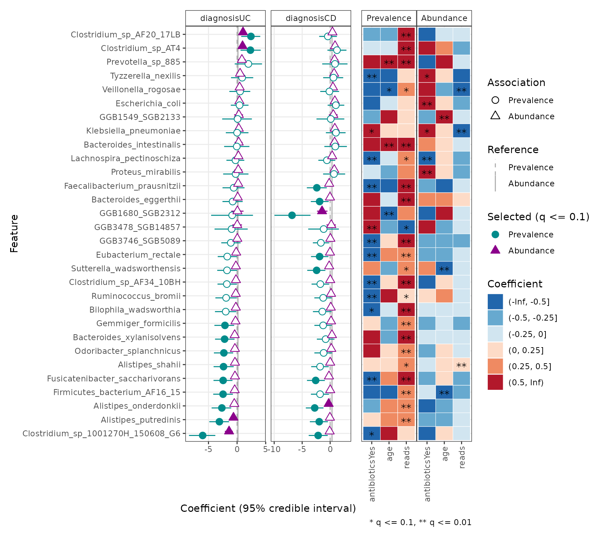
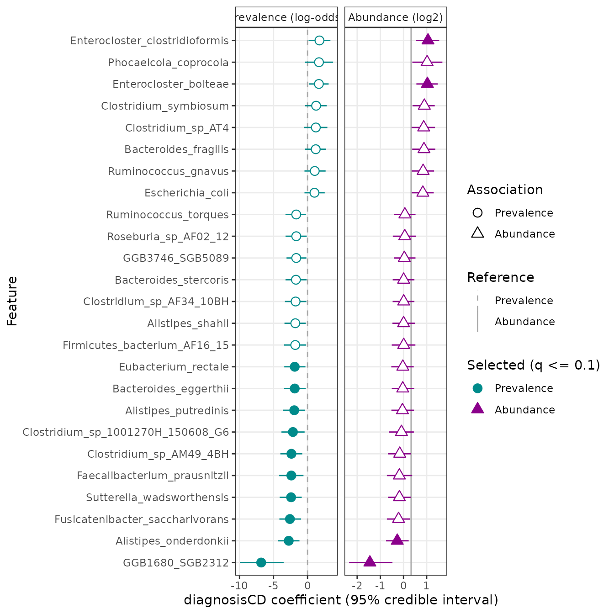
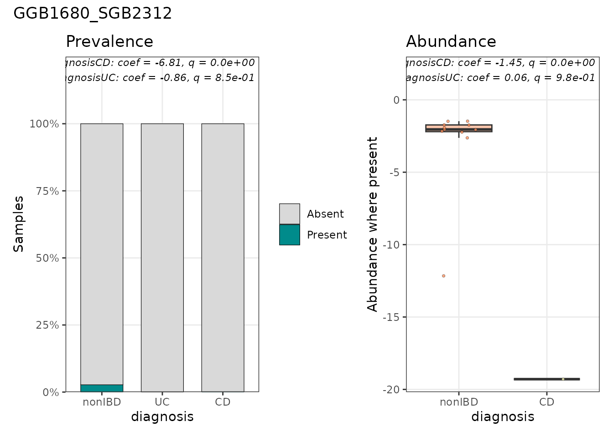
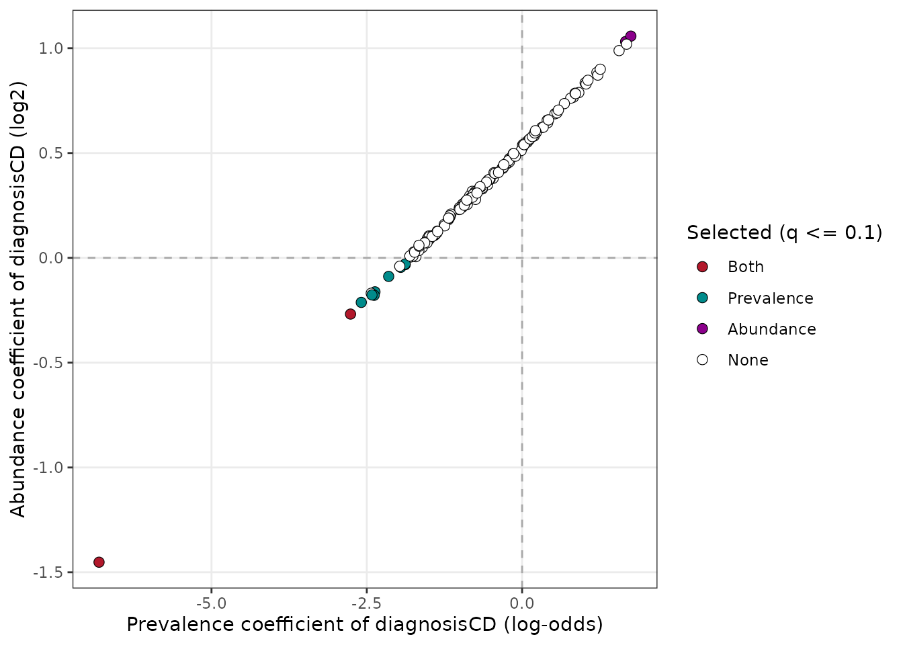

# Getting started with bayome

This vignette runs bayome on a real data set: stool metagenomes from the
inflammatory bowel disease cohort of the Integrative Human Microbiome
Project (HMP2 / IBDMDB). It shows how to

1.  prepare the data and write the model formula,
2.  fit the default model,
3.  read the results: effects, intervals, local false sign rates and
    q-values,
4.  plot them,
5.  look at the estimated link between prevalence and abundance,
6.  change the selection rule and the priors.

Fitting the model takes several minutes, so the vignette shows the call
and then reads results saved by `data-raw/hmp2_example.R`, which runs
exactly that call.

``` r

library(bayome)
```

## The data

The package includes the HMP2 example data distributed with MaAsLin3:
the relative abundances of 151 species in 1527 stool samples, and the
metadata of those samples. See `inst/extdata/README.md` for the source
and the citations.

``` r

taxa <- read.delim(system.file("extdata", "HMP2_taxonomy.tsv",
                               package = "bayome"), row.names = 1)
meta <- read.delim(system.file("extdata", "HMP2_metadata.tsv",
                               package = "bayome"), row.names = 1)
dim(taxa)
#> [1] 1527  151
taxa[1:3, 1:3]
#>            Phocaeicola_vulgatus Faecalibacterium_prausnitzii
#> CSM5FZ3N_P            0.4265226                  0.060255109
#> CSM5FZ3R_P            0.5369584                  0.007396904
#> CSM5FZ3T_P            0.5911821                  0.000000000
#>            Bacteroides_uniformis
#> CSM5FZ3N_P             0.2692411
#> CSM5FZ3R_P             0.2526048
#> CSM5FZ3T_P             0.0000000
```

Each participant gave several samples over time:

``` r

length(unique(meta$participant_id))
#> [1] 120
summary(as.vector(table(meta$participant_id)))
#>    Min. 1st Qu.  Median    Mean 3rd Qu.    Max. 
#>    1.00   10.00   12.00   12.72   17.25   25.00
table(meta$diagnosis)
#> 
#>     CD nonIBD     UC 
#>    685    405    437
```

Many species are present in only a few samples. These are the features
for which sharing information across features matters most:

``` r

n_present <- colSums(taxa > 0)
summary(n_present)
#>    Min. 1st Qu.  Median    Mean 3rd Qu.    Max. 
#>     3.0   126.0   434.0   493.6   778.0  1374.0
sum(n_present < 30)
#> [1] 13
```

We set the reference levels explicitly: healthy controls (`nonIBD`) and
no antibiotics.

``` r

meta$diagnosis <- factor(meta$diagnosis, levels = c("nonIBD", "UC", "CD"))
meta$antibiotics <- factor(meta$antibiotics, levels = c("No", "Yes"))
```

## The model formula

The question is how the microbiome differs between patients with Crohn’s
disease (CD) or ulcerative colitis (UC) and controls, so the
**exposure** is `diagnosis`. Antibiotic use, age and sequencing depth
(`reads`) are **adjustment covariates**. Repeated samples of the same
participant are handled with a random intercept, `(1 | participant_id)`.
The formula uses lme4 notation;
[`bm_inla_formula()`](https://jmartinez-minaya.github.io/bayome/reference/bm_inla_formula.md)
shows how bayome translates it for INLA, without fitting anything:

``` r

form <- ~ diagnosis + antibiotics + age + reads + (1 | participant_id)
bm_inla_formula(form, meta)
#> <bm_inla_model>
#> INLA formula:
#>   y ~ 1 + diagnosis + antibiotics + age + reads + f(.bm_re_participant_id, model = "iid", hyper = .bm_hyper$random)
```

The dysbiosis score of the HMP2 metadata is not used: it is computed
from the microbiome itself, so it is closer to an outcome than to a
covariate.

## Fitting the model

``` r

set.seed(1)
fit <- bayome(
  input_data     = taxa,
  input_metadata = meta,
  output         = "hmp2_bayome",
  formula        = form,
  exposure       = "diagnosis",
  normalization  = "TSS",
  transform      = "LOG",
  cores          = 4
)
```

The default model (`shrinkage = "joint"`) fits all species and both
parts in one INLA model. For the exposure (`diagnosisUC` and
`diagnosisCD`):

- **prevalence** (presence/absence, all samples): a logistic model, with
  each species estimated from its own data;
- **abundance** (log2 relative abundance, samples where the species is
  present): a linear model whose species effects are linked to the
  prevalence effects, `u_A = lambda * u_P + e`, and share a common
  prior.

The adjustment covariates get one effect per species and part, with a
fixed, weakly informative prior, so they add no hyperparameters. Here
the model has six: `lambda` and the spread of `e` for CD and for UC, and
the variance of the participant effect in each part. The residual
variances, one per species, are estimated outside INLA by variational
updates (`"vb"`).

Continuous covariates (`age`, `reads`) are standardised, abundance
effects are compared with their median across species (compositional
correction), and associations are selected by Benjamini–Hochberg on
2·lfsr.

`fit$results` holds the results table, and `output` gets
`all_results.tsv` and `significant_results.tsv`. Here we read the saved
results:

``` r

res <- read.delim(system.file("extdata", "HMP2_bayome_results.tsv",
                              package = "bayome"))
info <- read.delim(system.file("extdata", "HMP2_bayome_lambda.tsv",
                               package = "bayome"))
```

The fit took 4.8 minutes on a laptop with 4 threads.

## The results table

There is one row per species, coefficient and model part:

``` r

str(res)
#> 'data.frame':    1510 obs. of  18 variables:
#>  $ feature        : chr  "Alistipes_putredinis" "Clostridium_sp_1001270H_150608_G6" "Clostridium_sp_AF20_17LB" "Clostridium_sp_1001270H_150608_G6" ...
#>  $ metadata       : chr  "diagnosis" "diagnosis" "diagnosis" "diagnosis" ...
#>  $ value          : chr  "UC" "UC" "UC" "UC" ...
#>  $ name           : chr  "diagnosisUC" "diagnosisUC" "diagnosisUC" "diagnosisUC" ...
#>  $ coef           : num  -3.09 -6.02 1.04 -1.4 -2.42 ...
#>  $ stderr         : num  0.902 1.127 0.278 0.355 0.83 ...
#>  $ lower_95       : num  -4.857 -8.407 0.466 -2.143 -4.097 ...
#>  $ upper_95       : num  -1.398 -3.804 1.572 -0.742 -0.854 ...
#>  $ prob_positive  : num  0 0 1 0 0 0 0 0 1 0 ...
#>  $ lfsr           : num  0 0 0 0 0 0 0 0 0 0 ...
#>  $ qval_individual: num  0 0 0 0 0 0 0 0 0 0 ...
#>  $ lfsr_joint     : num  0 0 0 0 0 0 0 0 0 0 ...
#>  $ qval_joint     : num  0 0 0 0 0 0 0 0 0 0 ...
#>  $ null_hypothesis: num  0 0 0.158 0.158 0 ...
#>  $ error          : chr  NA NA NA NA ...
#>  $ model          : chr  "prevalence" "prevalence" "abundance" "abundance" ...
#>  $ N              : int  1527 1527 1527 1527 1527 1527 1527 1527 1527 1527 ...
#>  $ N_not_zero     : int  873 141 654 141 536 1119 12 12 312 1374 ...
```

`coef` is the posterior mean, `lower_95` and `upper_95` the 95% credible
interval, `lfsr` the probability that the sign of `coef` is wrong, and
`qval_individual` the q-value of the selection rule. There are no
p-values.

Number of associations at `qval_individual <= 0.1`, per coefficient and
model part:

``` r

sig <- res[!is.na(res$qval_individual) & res$qval_individual <= 0.1 &
             is.na(res$error), ]
table(sig$name, sig$model)
#>                 
#>                  abundance prevalence
#>   age                    7         13
#>   antibioticsYes        16         38
#>   diagnosisCD            4         10
#>   diagnosisUC            4         15
#>   reads                 18        102
```

The strongest associations with Crohn’s disease (`diagnosisCD`) in
abundance:

``` r

cd_abun <- sig[sig$name == "diagnosisCD" & sig$model == "abundance", ]
cd_abun <- cd_abun[order(cd_abun$qval_individual), ]
head(cd_abun[, c("feature", "coef", "lower_95", "upper_95", "lfsr",
                 "qval_individual", "N_not_zero")], 10)
#>                            feature       coef   lower_95   upper_95  lfsr
#> 8                  GGB1680_SGB2312 -1.4518326 -2.3479113 -0.4764332 0.000
#> 9   Enterocloster_clostridioformis  1.0576777  0.5492628  1.5420425 0.000
#> 171          Enterocloster_bolteae  1.0318472  0.5561010  1.4770612 0.001
#> 219          Alistipes_onderdonkii -0.2682234 -0.7521080  0.2243882 0.003
#>     qval_individual N_not_zero
#> 8        0.00000000         12
#> 9        0.00000000        312
#> 171      0.03894737        866
#> 219      0.09061224        831
```

Abundance effects are on the log2 scale: a `coef` of −2 means that, when
the species is present, its relative abundance is about four times lower
in Crohn’s disease than in controls, relative to the median species.

## Plots

All plot functions take a `bayome` fit or its results table, and return
a `ggplot` object that can be modified or saved with
[`ggplot2::ggsave()`](https://ggplot2.tidyverse.org/reference/ggsave.html).

**Overview.**
[`bm_plot_summary()`](https://jmartinez-minaya.github.io/bayome/reference/bm_plot.md)
shows the effects of the top species on every coefficient, with the
selected associations marked: the exposure in the coefficient plot on
the left (the default for a fit; with a results table we name the
coefficients) and the adjustment covariates in the heatmap:

``` r

bm_plot_summary(res, n_top = 30, coef_names = c("diagnosisUC", "diagnosisCD"))
```



**Effects with their intervals.**
[`bm_plot_effects()`](https://jmartinez-minaya.github.io/bayome/reference/bm_plot.md)
shows one coefficient in both parts, with 95% credible intervals:

``` r

bm_plot_effects(res, "diagnosisCD", n_top = 25)
```



**The data behind an association.**
[`bm_plot_association()`](https://jmartinez-minaya.github.io/bayome/reference/bm_plot.md)
shows, for one species and one variable, the share of samples where the
species is present and its abundance where present. With a fit it uses
`fit$data` and `fit$metadata`; here we build the same log2 table from
the raw data:

``` r

abun <- as.matrix(taxa / rowSums(taxa))
abun[abun == 0] <- NA
abun <- as.data.frame(log2(abun))
top_cd <- cd_abun$feature[1]
bm_plot_association(res, top_cd, "diagnosis", data = abun, metadata = meta)
```



## The link between prevalence and abundance

The model estimates one link `lambda` per exposure coefficient: how much
the abundance effects follow the prevalence effects across species. With
`lambda` near 0 the two parts are unrelated and the abundance part
reduces to a hierarchical model; with `lambda > 0`, species that become
less frequent also tend to become less abundant when present.

``` r

info[, c("name", "lambda")]
#>          name    lambda
#> 1 diagnosisUC 0.2785170
#> 2 diagnosisCD 0.2908058
```

[`bm_plot_link()`](https://jmartinez-minaya.github.io/bayome/reference/bm_plot.md)
shows the prevalence and abundance effects of each species for one
coefficient. With a fit, the estimated `lambda` appears in the subtitle;
`fit$lambda` holds all of them.

``` r

bm_plot_link(res, "diagnosisCD")
```



For a species with few non-zero samples, the abundance effect borrows
from its prevalence effect through `lambda`, instead of being shrunk
towards zero.

## Choosing a selection rule

`selection` sets how the posterior probabilities become q-values:

- `"bh_lfsr"` (default): Benjamini–Hochberg on 2·lfsr;
- `"rope"`: posterior probability that the effect is practically null,
  P(\|effect\| ≤ `rope_delta`), with `rope_delta = 0.5` by default;
- `"lfsr"`: running mean of the sorted lfsr.

The rule only changes the q-values, not the posteriors, so it can be
compared on the saved `lfsr`. For `diagnosisCD` in abundance:

``` r

d <- res[res$name == "diagnosisCD" & res$model == "abundance" &
           is.na(res$error), ]
c(bh_lfsr = sum(p.adjust(pmin(2 * d$lfsr, 1), "BH") <= 0.1),
  lfsr = sum(bm_qvalue(d$lfsr) <= 0.1))
#> bh_lfsr    lfsr 
#>       3      63
```

The running-mean rule selects more: for species without an effect the
lfsr behaves like a one-sided p-value, so averaging lfsr values lets
more of them through. The default controls the false discovery rate.

## Priors

Priors are set with
[`bm_prior()`](https://jmartinez-minaya.github.io/bayome/reference/bm_prior.md)
and passed to `bayome(prior = )`. For example, a less informative prior
for the prevalence effects of each species:

``` r

pr <- bm_prior(fixed_sd_prevalence = 5)
pr$fixed
#> $prevalence
#> [1] 0.04
#> 
#> $abundance
#> [1] 0.01
#> 
#> $adjustment
#> [1] 0.16
```

``` r

fit2 <- bayome(taxa, meta, output = NULL, formula = form, prior = pr)
```

## Session information

``` r

sessionInfo()
#> R version 4.6.2 (2026-10-29)
#> Platform: x86_64-pc-linux-gnu
#> Running under: Ubuntu 26.04.1 LTS
#> 
#> Matrix products: default
#> BLAS:   /usr/lib/x86_64-linux-gnu/openblas-pthread/libblas.so.3 
#> LAPACK: /usr/lib/x86_64-linux-gnu/openblas-pthread/libopenblasp-r0.3.32.so;  LAPACK version 3.12.0
#> 
#> locale:
#>  [1] LC_CTYPE=C.UTF-8       LC_NUMERIC=C           LC_TIME=C.UTF-8       
#>  [4] LC_COLLATE=C.UTF-8     LC_MONETARY=C.UTF-8    LC_MESSAGES=C.UTF-8   
#>  [7] LC_PAPER=C.UTF-8       LC_NAME=C              LC_ADDRESS=C          
#> [10] LC_TELEPHONE=C         LC_MEASUREMENT=C.UTF-8 LC_IDENTIFICATION=C   
#> 
#> time zone: UTC
#> tzcode source: system (glibc)
#> 
#> attached base packages:
#> [1] stats     graphics  grDevices utils     datasets  methods   base     
#> 
#> other attached packages:
#> [1] bayome_0.0.0.9000
#> 
#> loaded via a namespace (and not attached):
#>  [1] Matrix_1.7-6       gtable_0.3.6       jsonlite_2.0.0     dplyr_1.2.1       
#>  [5] compiler_4.6.2     tidyselect_1.2.1   jquerylib_0.1.4    systemfonts_1.3.4 
#>  [9] scales_1.4.0       textshaping_1.1.0  yaml_2.3.12        fastmap_1.2.0     
#> [13] lattice_0.23-1     ggplot2_4.0.4      R6_2.6.1           labeling_0.4.3    
#> [17] patchwork_1.3.2    generics_0.1.4     knitr_1.52         rbibutils_2.4.1   
#> [21] tibble_3.3.1       desc_1.4.3         bslib_0.12.0       pillar_1.11.1     
#> [25] RColorBrewer_1.1-3 rlang_1.3.0        cachem_1.1.0       xfun_0.62         
#> [29] fs_2.1.0           sass_0.5.0         S7_1.0.0           otel_0.3.0        
#> [33] cli_3.6.6          withr_3.0.3        pkgdown_2.2.1      magrittr_2.0.5    
#> [37] Rdpack_2.6.6       digest_0.6.39      grid_4.6.2         lifecycle_1.0.5   
#> [41] reformulas_0.4.4   vctrs_0.7.3        evaluate_1.0.5     glue_1.8.1        
#> [45] farver_2.1.2       ragg_1.5.2         rmarkdown_2.32     tools_4.6.2       
#> [49] pkgconfig_2.0.3    htmltools_0.5.9
```
